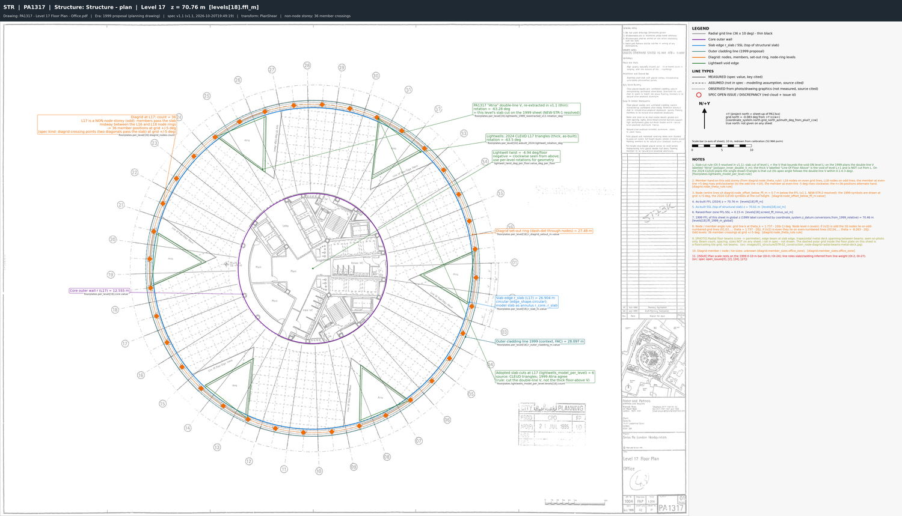
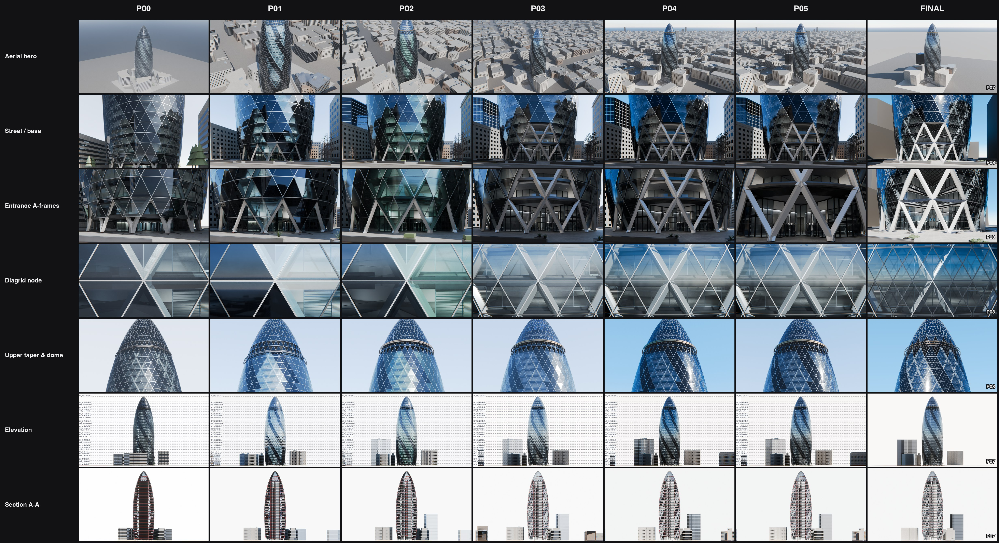
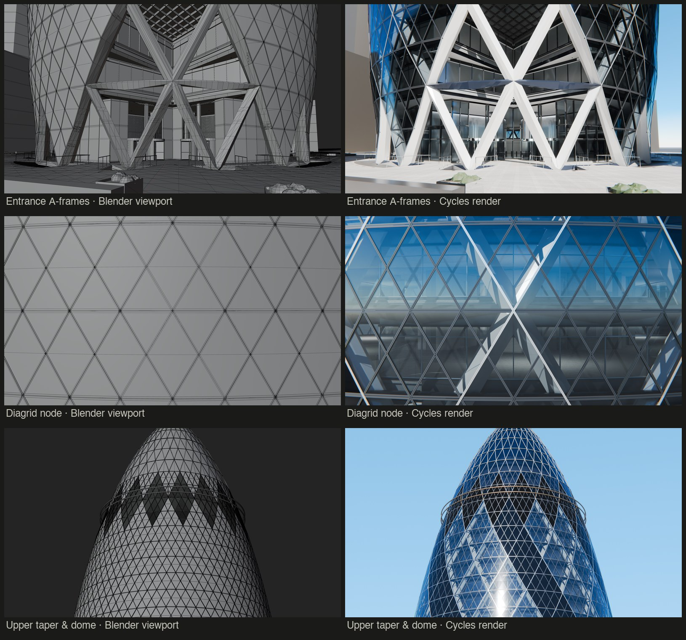

# SKILL 1: Pre-processing of Architectural Drawings

## What this skill does
You give Claude a folder of architectural drawings (and some photos, if you have them). Claude reads them carefully, measures the building, and produces one tidy package that another AI can use to build an accurate 3D model.

## How to run it
1. Install the `aecfn-building-modelling-brief` folder in your project's `.claude/skills/` folder.
2. Open Claude Code in that project, use your own version of the following prompt:

> Use the aecfn-building-modelling-brief skill to prepare a modelling brief for **30 St Mary Axe (the Gherkin)**.
> Drawings are in `ref/drawings`, photos are in `ref/images`.
> Spawn 4 parallel Opus 5.5 specialist subagents managed and reviewed by a Opus 5.5 Master Orchestrator (`Model="inherit"` for all), 
> Where sources conflict, use the most recent information.

Swap in your own building and folders. Claude will ask about anything it can't work out, and check in with you at the key decisions.

## What happens, step by step
1. **Sorting the pile:** The skill first finds the drawing frame on every sheet, straightens tilted scans, and crops each one tight to its border, saving the result as a PNG and a PDF. It then reads each title block and records the drawing number, title, revision, scale and paper size, and checks whether the scan is at paper size. Only then does it drop duplicates and old versions

2. **Lining everything up:** Because each drawing of the Gherkin is a raster file, the skill finds known points, such as the numbered grid bubbles around the building, and fits the drawing to real-world metres. It then checks the fit against a dimension it didn't use, so mistakes get caught

   Example: On the Level 20 plan, Claude found all 36 grid bubbles (red) and fitted the radial grid through them (green), with grid line 01 in blue

   

3. **Measuring the building:** The skill reads for example floor heights, the curved outline, the cores and the atria, and writes them into one master file (the "spec"). Each number notes which drawing it came from and how sure Claude is about it. 

   

   When two drawing sets disagree, Claude compares them side by side instead of picking one at random. Here the 1999 planning drawings (top) are compared with the 2024 survey (bottom). This was only necessary because I inputed to drawing sets, instead of only the latest. I did so to verify the accuracy of the 1999 set. 

   

4. **Drawing the numbers back on:** The skill then draws its measurements back onto the original drawings, colour-coded by type: structure, facade, interior and site. If a coloured line doesn't sit on the drawn line, something is wrong, and Claude fixes it. The purpose of these marked-up sheets is to show the 3D modeller Agents later what each number means.

   

   

5. **Sorting the photos:** Claude removes duplicates, files the photos in build order, and writes a note for each one: what it shows, what to use it for (materials, colours, how parts join) and what to ignore. Photos are never used for measurements, but area a crucial reference

6. **Final checks:** Claude runs a final check, making sure every number traces back to a drawing and every marked-up sheet matches the spec. 

## What you get
One folder (for the Gherkin, `gherkin_brief_v1.1`) containing:

| In the folder | What it's for |
|---|---|
| `00_README.md` | A guide to the package |
| `spec/` | The master file of measurements |
| `markups/` | Colour-coded drawings explaining the numbers |
| `underlays/` | Drawings at true scale, to place in Blender as tracing references |
| `images/` | The curated photos and their notes |

Claude also tells you how accurate the result is and which questions still need a human decision.

## The scripts in the skill

| Script | What it does |
|---|---|
| `sheet_prep.py` | Runs first. Finds the drawing frame on every drawing (PDF or scanned TIF/JPG/PNG), straightens tilted scans and crops them tight to the frame as PNG and PDF, makes a readable image of each title block, and records the drawing number, title, scale and paper size read from it. |
| `inventory.py` | Catalogues the cropped drawings (page size, scale, title, scanned or vector) and makes thumbnails and a drawing index. |
| `calibrate.py` | Fits each drawing to real-world metres from known points such as grid bubbles and level tags, and checks the fit against a dimension it didn't use. |
| `pdf_vectors.py` | Reads lines, circles, text and CAD layers straight out of vector PDFs, optionally converted to metres. |
| `raster_tools.py` | Finds grid bubbles and level lines on scanned (image-only) drawings, so they can be calibrated too. |
| `pair_levels.py` | Matches the level lines found on a scanned section to a table of floor heights. |
| `rectify.py` | Turns each calibrated drawing into a true-scale image (an "underlay") that drops straight into Blender. |
| `view_underlay.py` | Crops an underlay with a metre grid, or traces a profile across it, so measurements can be read off in real-world units. |
| `markup.py` | Draws the measured values from the spec back onto the underlays as colour-coded markups. |
| `curate_images.py` | Finds duplicate photos, makes previews, and files the chosen photos into folders under clear names. |
| `validate.py` | Checks the brief before hand-over: every number has a source, every markup matches the spec, and no files are missing. |
| `package_brief.py` | Gathers only what the modeller needs into the brief folder, and runs the validation again before writing it. |
| `bmb_common.py` | Shared helpers used by the other scripts (reading the spec, paper sizes, scale maths). |

# SKILL 2: 3D Modelling in Blender

## What this skill does
You give Claude the brief folder made by Skill 1. Claude rebuilds the building in Blender at real size, with structure, facade, interior and site, taking every dimension from the brief's measurements. Before anything is judged by eye, the model is checked against numbers: floor levels and radii against the spec, and the model's outline laid over every drawing. A team of Claude agents then refines the model pass by pass, each one owning one part of the building, while a fresh reviewer scores every round of renders against the photos. You get Cycles renders, a section cut beside the real section drawing, IFC files and a report.

## How to run it
1. Install the `aecfn-building-3d-modelling-blender` folder in your project's `.claude/skills/` folder.
2. Install Blender 5.2 and a Python 3.11 (or newer) environment with `manifold3d ifcopenshell ezdxf matplotlib pillow numpy`.
3. Put the brief folder from Skill 1 in the project, open Claude Code there, and use your own version of the following prompt:

> Build a complete multi-zone 3D architectural reconstruction of **30 St Mary Axe (the Gherkin)** in Blender using the `aecfn-building-3d-modelling-blender` pipeline.
> Brief package: `gherkin_brief_v1.1/`. Read `00_README.md` first. Never edit `spec/gherkin_spec.json`, the markups, the underlays or the images.
> Spawn parallel Opus 5.5 specialist subagents managed and reviewed by an Opus 5.5 Orchestrator (`Model="inherit"` for all).
> Give every photo a matching camera, rendering in Cycles a showcase and a Before-vs-After progression matrix.
> Run caffeinate for the whole run. Ask me if anything is missing.

Swap in your own building and brief folder. Before building, Claude confirms the era, the coordinate frame, the zones and the accuracy targets with you. Long runs take hours: `caffeinate` keeps a Mac awake.

## What happens, step by step
1. **Preflight.** It checks Blender, the venv, `.env` and that the brief package is complete. If anything is missing, it asks before starting.
2. **Bootstrap.** It copies the pipeline into the project, starts a git repo and writes `spec/site.json` from the template.
3. **Read and plan.** It reads the package and writes the thin `site.json`: datums, zones in build order, drawing sheets, checks and cameras. It also seeds one Python module per zone (structure, facade, interior, base).
4. **Checklists and decisions.** The markups become a checklist for each zone. Every unknown value and open issue needs a row in `decisions_log.md` before the build can continue.
5. **Blueprint.** It generates the geometry from the spec: CSG solids for slabs, cores and voids, and parametric meshes and instances for members, mullions and panels. Outputs are an IFC4 model per discipline, a DXF, and a multi-panel blueprint drawn over the real drawings.
6. **Measured gate.** It checks levels, radii, node points, polygons and counts against the spec. One failure blocks the pass.
7. **Overlay gate.** It draws the model's linework over every calibrated drawing and reports how far apart they are in metres.
8. **Compile.** It builds the Blender scene at 1:1. This adds datum edge loops, metric UVs, PBR materials, hidden reference drawings, the camera rig and section cutaways. A QA gate then checks names, budgets and cameras.
9. **Gauntlet loop.** One subagent works on each zone, in dependency order. A zone is frozen once it passes its gates. Each pass, a fresh adversarial critic scores the renders against the photos. The orchestrator turns the critic's findings into work orders and repeats until the score plateaus or the pass budget runs out.

   

10. **Delivery.** You get a rendered Cycles showcase, a section cutaway next to the as-built section, an overlay matrix, a before/after progression matrix, styled IFCs, `decisions_log.md` and `REPORT.md`.

    The same three views in the Blender viewport (left) and as final Cycles renders (right): the entrance A-frames, a diagrid node, and the upper taper and dome.

    

## The scripts in the skill

| Script | What it does |
|---|---|
| `pipeline/run.py` | Single entry point: every command (`cycle`, `measure`, `render`, `freeze`, `status`…) and the run state. |
| `pipeline/aep_spec.py` | Loads `site.json` and the measured spec, and derives the named datums (`FFL_17`, `SSL_17`…). |
| `pipeline/specq.py` | Small query language for reading values out of the large spec JSON. |
| `pipeline/markup_checklist.py` | Turns markup callouts into per-zone checklists and issue/assumption registers. |
| `pipeline/decisions.py` | Checks that every assumption and open issue has a row in `decisions_log.md`. |
| `pipeline/stage01_blueprint.py` | Builds the zone geometry, validates it and draws the N-panel ANSI31 blueprint. |
| `pipeline/geom_io.py` | Saves and loads geometry as `.npz` files plus a manifest, so Python and Blender can share it. |
| `pipeline/linework.py` | Cuts meshes with planes and extracts feature edges for drawings. |
| `pipeline/ifc_export.py` | Writes IFC4 files per discipline with storeys, IFC classes, styled materials and mapped instances. |
| `pipeline/ifc_styles.py` | Renders a swatch of each Blender material so IFC colours match the render. |
| `pipeline/measure.py` | Measured gate: level, extent, radius, point, polygon and count checks against the spec. |
| `pipeline/overlay.py` | Overlay gate: draws the model over each underlay and reports deviation figures and a matrix. |
| `pipeline/underlays.py` | Reads the calibrated drawings' sidecars and converts between pixels and world coordinates. |
| `pipeline/stage03_compile.py` | Compiles everything 1:1 into a Blender scene: materials, reference planes, cameras, cutaways. |
| `pipeline/aep_blender.py` | Blender helpers: datum imprinting, metric UVs, PBR, lighting and studio polish. |
| `pipeline/qa_checks.py` | QA gate inside Blender: naming, hidden references, tri budget, camera clipping. |
| `pipeline/stage04_render.py` | Renders a pass's cameras with Cycles, one render at a time. |
| `pipeline/contact_sheet.py` | Builds labelled contact sheets and the before/after progression matrix. |
| `zones/_template.py` | Starting point for a zone module (assumptions, solids, meshes, instances, materials). |
| `zones/lib_geom.py` | Parametric geometry kit: prisms, sweeps, tubes, panels, revolves and ring arrays. |

