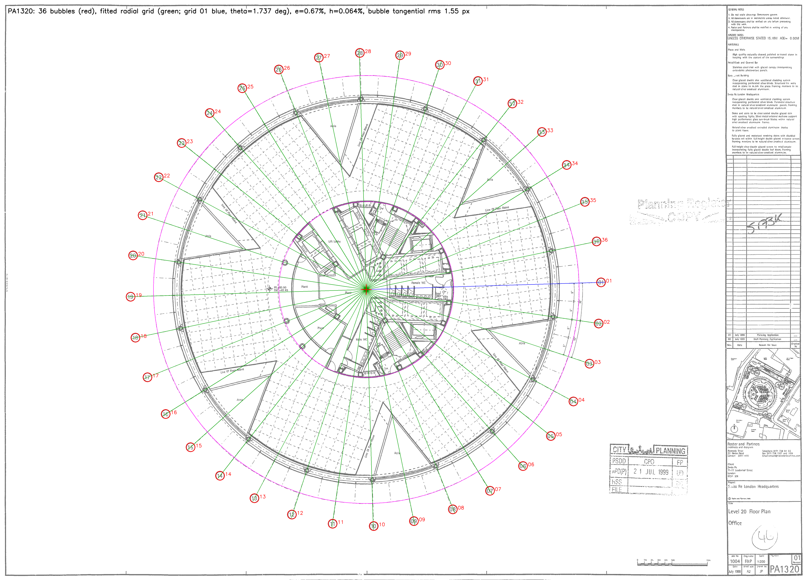
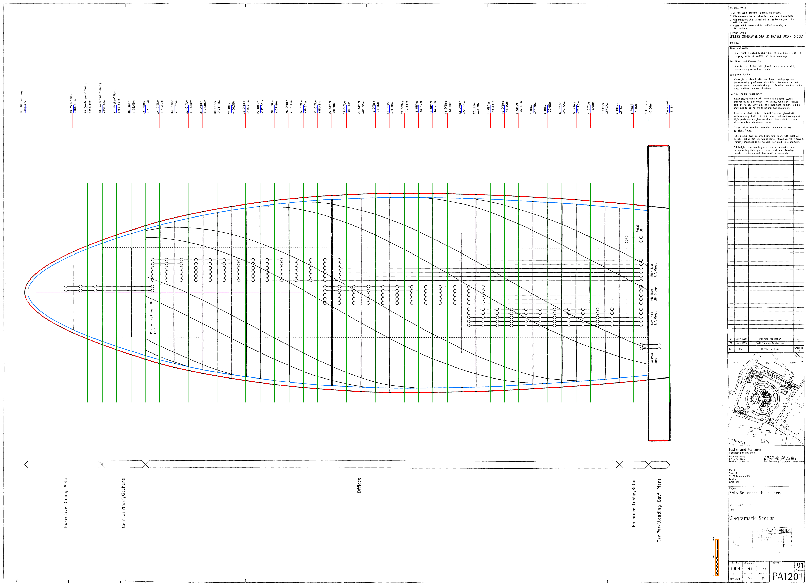
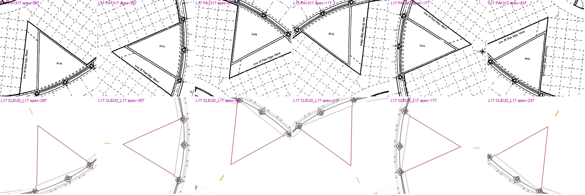
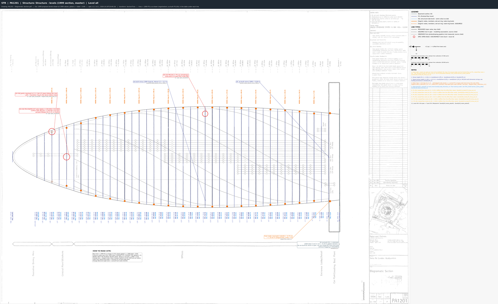

# SKILL 1: Pre-processing of Architectural Drawings

## What this skill does
You give Claude a folder of architectural drawings (and some photos, if you have them). Claude reads them carefully, measures the building, and produces one tidy package that another AI can use to build an accurate 3D model.

## How to run it
1. Install the `aecfn-building-modelling-brief` folder in your project's `.claude/skills/` folder.
2. Open Claude Code in that project, use your own version of the following prompt:

> Use the aecfn-building-modelling-brief skill to prepare a modelling brief for **30 St Mary Axe (the Gherkin)**.
> Drawings are in `ref/drawings`, photos are in `ref/images`.
> Spawn 4 parallel Opus 5.5 specialist subagents managed and reviewed by a Opus 5.5 Master Orchestrator (`Model="inherit"` for all), 
> Where sources conflict, use the most recent information.

Swap in your own building and folders. Claude will ask about anything it can't work out, and check in with you at the key decisions.

## What happens, step by step
1. **Sorting the pile:** The skill opens every file, drops duplicates and old versions

2. **Lining everything up:** Because each drawing of the Gherkin is a raster file, the skill finds known points, such as the numbered grid bubbles around the building, and fits the drawing to real-world metres. It then checks the fit against a dimension it didn't use, so mistakes get caught

   Example: On the Level 20 plan, Claude found all 36 grid bubbles (red) and fitted the radial grid through them (green), with grid line 01 in blue

   

3. **Measuring the building:** The skill reads for example floor heights, the curved outline, the cores and the atria, and writes them into one master file (the "spec"). Each number notes which drawing it came from and how sure Claude is about it. 

   

   When two drawing sets disagree, Claude compares them side by side instead of picking one at random. Here the 1999 planning drawings (top) are compared with the 2024 survey (bottom). This was only necessary because I inputed to drawing sets, instead of only the latest. I did so to verify the accuracy of the 1999 set. 

   

4. **Drawing the numbers back on:** The skill then draws its measurements back onto the original drawings, colour-coded by type: structure, facade, interior and site. If a coloured line doesn't sit on the drawn line, something is wrong, and Claude fixes it. The purpose of these marked-up sheets is to show the 3D modeller Agents later what each number means.

   

   

5. **Sorting the photos:** Claude removes duplicates, files the photos in build order, and writes a note for each one: what it shows, what to use it for (materials, colours, how parts join) and what to ignore. Photos are never used for measurements, but area a crucial reference

   

6. **Final checks:** Claude runs a final check, making sure every number traces back to a drawing and every marked-up sheet matches the spec. 

## What you get
One zip file (for the Gherkin, `gherkin_brief_v1.1.zip`) containing:

| In the zip | What it's for |
|---|---|
| `00_README.md` | A guide to the package |
| `spec/` | The master file of measurements |
| `markups/` | 28 colour-coded drawings explaining the numbers |
| `underlays/` | 10 drawings at true scale, to place in Blender as tracing references |
| `images/` | The curated photos and their notes |

Claude also tells you how accurate the result is and which questions still need a human decision.

## The scripts in the skill
The skill's `scripts/` folder holds the Python tools Claude runs along the way, listed here in the order they're used.

| Script | What it does |
|---|---|
| `inventory.py` | Catalogues every PDF in the drawings folder (page size, scale, title, scanned or vector) and makes thumbnails and a drawing index. |
| `calibrate.py` | Fits each drawing to real-world metres from known points such as grid bubbles and level tags, and checks the fit against a dimension it didn't use. |
| `pdf_vectors.py` | Reads lines, circles, text and CAD layers straight out of vector PDFs, optionally converted to metres. |
| `raster_tools.py` | Finds grid bubbles and level lines on scanned (image-only) drawings, so they can be calibrated too. |
| `pair_levels.py` | Matches the level lines found on a scanned section to a table of floor heights. |
| `rectify.py` | Turns each calibrated drawing into a true-scale image (an "underlay") that drops straight into Blender. |
| `view_underlay.py` | Crops an underlay with a metre grid, or traces a profile across it, so measurements can be read off in real-world units. |
| `markup.py` | Draws the measured values from the spec back onto the underlays as colour-coded markups. |
| `curate_images.py` | Finds duplicate photos, makes previews, and files the chosen photos into folders under clear names. |
| `validate.py` | Checks the brief before hand-over: every number has a source, every markup matches the spec, and no files are missing. |
| `package_brief.py` | Gathers only what the modeller needs, runs the validation again, and zips the brief. |
| `bmb_common.py` | Shared helpers used by the other scripts (reading the spec, paper sizes, scale maths). |
